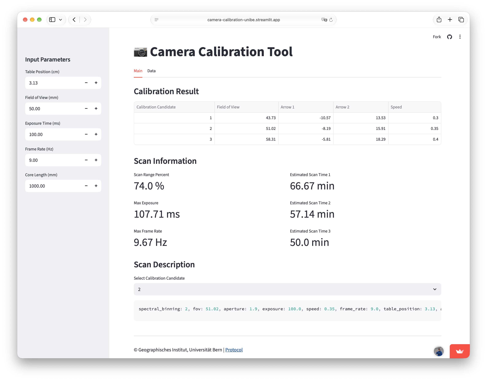

# Camera Calibration Tool

A Streamlit web app for calculating line-scanner camera settings from a target field of view and sample-table position.
It uses measured calibration data and linear regression to predict arrow positions, suggest scan speeds, and estimate
scan times.



## Features

- Compare three calibration candidates around the closest achievable field of view.
- Calculate Arrow 1 and Arrow 2 positions and the sample-tray speed for each candidate.
- View estimated scan times, scan range percentage, maximum exposure time, and maximum frame rate.
- Receive a warning when the exposure time is too high for the selected frame rate.
- Select a candidate to generate a copyable scan description.
- Inspect the underlying calibration measurements in the **Data** tab.

## Run locally

### 1. Get the project

```bash
git clone https://github.com/Karottehaus/camera-calibration.git
cd camera-calibration
```

### 2. Install dependencies

```bash
python3.12 -m venv .venv
source .venv/bin/activate
python -m pip install -r requirements.txt
```

### 3. Start the app

Run this from the project root with the virtual environment activated:

```bash
python -m streamlit run app.py
```

Open [http://localhost:8501](http://localhost:8501) if your browser does not open automatically. Press **Control+C** in
Terminal to stop the app.

## Usage

1. Enter your scan parameters in the sidebar:

   | Parameter | Unit | Default |
   | --- | --- | --- |
   | Table Position | cm | 3.13 |
   | Field of View | mm | 50.00 |
   | Exposure Time | ms | 100.00 |
   | Frame Rate | Hz | 9.00 |
   | Core Length | mm | 1000.00 |

2. Review the three candidates and their estimated scan times in the **Main** tab. Results update when you change an
   input.
3. Choose a candidate under **Scan Description** and copy the generated settings.
4. Open the **Data** tab to inspect the measurements used to fit the regression model.

The generated scan description uses fixed values of `spectral_binning: 2` and `aperture: 1.9`.

## Project structure

```text
camera-calibration/
├── .devcontainer/
│   └── devcontainer.json       # Optional development-container setup
├── assets/
│   └── screenshot.png          # App screenshot
├── data/
│   └── camera_position.csv     # Measured calibration data
├── interface/
│   ├── inputs.py               # Sidebar input controls
│   ├── results.py              # Results, metrics, and scan description
│   └── warning.py              # Exposure-time warning
├── src/
│   ├── calculation_helpers.py  # Calibration candidates and scan calculations
│   ├── data_loader.py          # Cached CSV loading
│   └── regression_model.py     # Cached linear-regression fitting
├── .gitignore
├── app.py                      # Streamlit entry point and page layout
├── LICENSE
├── README.md
├── requirements.txt            # Pinned Python dependencies
└── settings.py                 # Data paths and scanner constants
```

## Protocol

See the [scanning protocol](https://dx.doi.org/10.17504/protocols.io.36wgqxze3lk5/v1) for data acquisition.

See the [processing protocol](https://dx.doi.org/10.17504/protocols.io.4r3l2xmxpv1y/v1) for data analysis with
napari-sediment.

## Licence

Released under the [MIT License](LICENSE).
